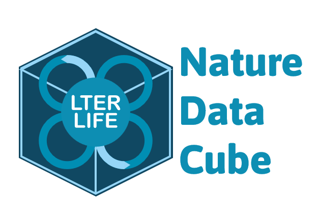

# NatureDataCube

Meta-repository for the general development and issue-tracking of _NatureDataCube_ components.

_NatureDataCube_ is currently being develped within the framework of [LTER-LIFE](https://lter-life.nl/en), and offers an accessible way for researchers/ecologists to retrieve relevant data.

## Subrepositories

- [**rNDC**](https://github.com/LTER-LIFE/rNDC): R package with functions and wrappers for interfacing with LTER-LIFE's _NatureDataCube_, simplifying access to geospatial environmental datasets for Dutch nature areas.

- [**rNDC-Shiny**](https://github.com/LTER-LIFE/rNDC-Shiny): Graphical user interface (GUI) to LTER-LIFE's _NatureDataCube_, based on R-Shiny, using functions from [rNDC](https://github.com/LTER-LIFE/rNDC).

- [**VL-NatureDataCube**](https://github.com/LTER-LIFE/VL-NatureDataCube): Virtual Lab in [_NaaVRE_](https://naavre.net) for implementing and testing workflows, as well as for training purposes involving LTER-LIFE's _NatureDataCube_.
